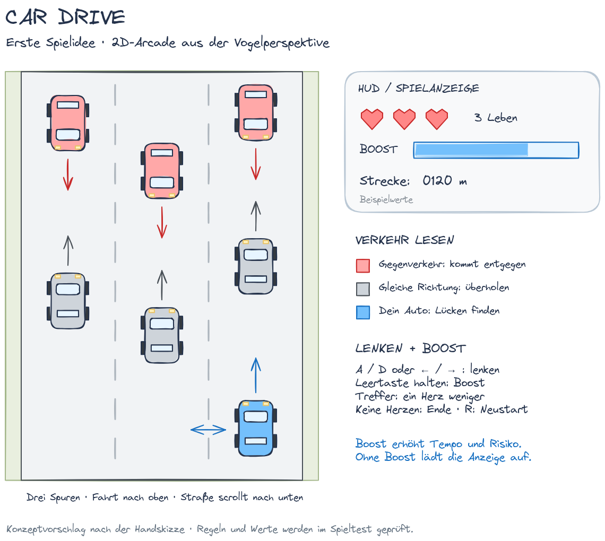

# Problem

Der Starter-Platformer liefert ein lauffähiges Grundgerüst, bildet aber die erste
eigene Spielidee noch nicht ab: ein Autospiel, in dem man Verkehr ausweicht und
einen Boost im richtigen Moment einsetzt. Der erste Prototyp soll zeigen, ob sich
Lenken, Überholen und Ausweichen auf engem Raum gut anfühlen.

**Status: umgesetzt als erster Prototyp.** Car Drive ersetzt den Starter.
Die [Architekturdokumentation](../../architecture/README.md) beschreibt die
konkreten Regeln und Anfangswerte; Lenkgefühl und Balance bleiben Spieltestaufgaben.

# Solution

Ein kleines 2D-Arcade-Autospiel aus der Vogelperspektive: Das eigene Auto fährt
auf einer geraden Straße mit drei Spuren. Andere Autos fahren in derselben oder
in der entgegengesetzten Richtung. Man sucht Lücken, wechselt die Spur und fährt
so weit wie möglich, bevor die drei Leben verbraucht sind.

## Skizze und Lesart

Die [Originalskizze](first-idea.jpg) ist die Grundlage. Die
[bearbeitbare Excalidraw-Zeichnung](car-drive.excalidraw) überträgt sie in ein
aufrechtes Spielfeld und ergänzt Beschriftungen:

Aus der Vorlage übernommen sind drei Spuren, Autos mit Richtungspfeilen, das
Spielerauto, drei Herzen und eine Boost-Anzeige. Die genaue Bedeutung des
eingekreisten Objekts ist offen; daraus entsteht vorerst kein eigenes Spielelement.
Die folgenden Regeln sind Vorschläge für den ersten Prototyp, keine aus der
Zeichnung abgelesenen Festlegungen.

## Fahren und ausweichen

Das Spielerauto steht im unteren Bildschirmbereich und fährt automatisch nach
oben. Straße und Verkehr bewegen sich relativ zum eigenen Tempo durch das Bild.
Links und rechts lenken stufenlos über die drei Spuren; die Straßenränder begrenzen
die Bewegung. Beim Loslassen endet die seitliche Bewegung zügig. Die erste
Version braucht weder manuelles Gasgeben noch Bremsen.

Langsamere Autos in gleicher Fahrtrichtung werden eingeholt; Gegenverkehr nähert
sich schneller. Fahrzeuge bleiben auf ihrer Spur und sind durch ihre erkennbare
Front unterscheidbar. Die Pfeile in der Zeichnung erklären die Fahrtrichtung;
sie sind keine verpflichtende Spielanzeige. Für dieses Arcade-Experiment dürfen
beide Verkehrsrichtungen auf jeder Spur auftreten. Es gibt keine Kreuzungen.

Zunächst reichen wenige wiederholbare Verkehrsmuster mit ausreichend Vorlauf und
einer erreichbaren Lücke. Neue Autos erscheinen außerhalb des sichtbaren Bereichs,
niemals direkt auf dem Spieler. Die Herausforderung entsteht aus dem Ausweichen,
nicht aus einer ständig steigenden Geschwindigkeit.

## Boost und drei Leben

Eine gehaltene Boost-Taste erhöht das Vorwärtstempo, solange die angezeigte
Boost-Energie reicht. Loslassen oder eine leere Anzeige beendet den Boost.
Ohne Boost lädt sich die Energie langsam wieder auf. Der Boost bringt schneller
Strecke, verkürzt aber die Reaktionszeit; er schützt nicht vor Kollisionen.

Jeder Zusammenstoß kostet ein Herz. Ein kurzer, deutlich sichtbarer Schutz nach
einem Treffer verhindert, dass dieselbe Berührung mehrere Leben verbraucht, und
gibt Zeit zum Ausweichen. Die Fahrt läuft weiter. Bei null Herzen endet sie;
Verkehr und Streckenzähler halten an, das Ergebnis und „Neustart“ werden angezeigt.

Das HUD zeigt drei Herzen, den Boost-Füllstand und die zurückgelegte Strecke.
Ein Neustart setzt Auto, Verkehr, Strecke, Leben und Boost vollständig zurück.
Der Versuch beginnt mit drei Herzen und voller Boost-Energie. Es gibt zunächst
kein festes Ziel; die Strecke ist der Vergleichswert für den nächsten Versuch.

## Bedienung und Umfang des ersten Experiments

Tastatur: A/D oder Pfeiltasten links/rechts lenken, Leertaste aktiviert Boost,
R startet neu und Escape beendet das Spiel. Am Controller lenken linker Stick
oder Steuerkreuz, die untere Aktionstaste aktiviert Boost und Select startet neu.
Ein kurzer Hinweis im HUD macht die Belegung sichtbar.

Eine Straße und einfache, gut unterscheidbare Fahrzeugformen genügen. Das neue
Spiel ersetzt beim Start den Platformer vollständig: keine Spielauswahl, keine
Sprünge, Plattformen, Münzen oder Zielflagge. Das bestehende Bevy-Grundgerüst mit
getrennter Simulation und Darstellung bleibt die Grundlage. Eingaben erreichen
die Simulation weiterhin über `Controls`; Architekturtexte und betroffene ADRs
werden bei der Umsetzung an das tatsächlich gebaute Spiel angepasst.

Das Experiment ist spielbar, wenn man kontrolliert ausweichen, beide
Verkehrsrichtungen erkennen, Boost dosieren, drei nachvollziehbare Treffer
erleiden und sofort einen frischen Versuch starten kann. Automatisierte
Simulationstests sollen Straßenbegrenzung, Boost-Verbrauch und Aufladung,
Trefferschutz, Spielende und vollständigen Neustart prüfen. Eine Spielprobe
prüft zusätzlich Lenkgefühl, lesbaren Verkehr und faire Lücken, auch mit Boost.

# Security

Der Prototyp läuft lokal, ohne Netzwerk, Konten, gespeicherte Spielstände oder
extern geladene Strecken. Verkehrsmuster stammen aus dem Spiel selbst. Dieser
Pitch führt keine zusätzliche Verarbeitung nicht vertrauenswürdiger Inhalte ein.

# Rabbit Holes

- **Fahrzeugsimulation:** Reifenhaftung, Drift, Getriebe und realistische Unfälle
  würden die zentrale Frage nach dem Ausweichgefühl überlagern. Direkte
  Arcade-Steuerung genügt.
- **Unfairer Verkehr:** Freier Zufall kann alle Spuren gleichzeitig blockieren.
  Mit wenigen prüfbaren Mustern beginnen und erreichbare Lücken sicherstellen.
- **Boost und Kollisionen:** Auch bei hohem Relativtempo müssen Treffer zuverlässig
  erkannt werden. Geschwindigkeit und Kollisionsprüfung gemeinsam testen;
  Fahrzeuge dürfen zwischen Simulationsschritten nicht unbemerkt aneinander vorbei.
- **Zu viele offene Zahlen:** Tempo, Lenkgeschwindigkeit, Schutzdauer und
  Boost-Aufladung sind Spieltestwerte. Erst ein gut spielbares Grundgefühl finden.
- **Unklare Symbole:** Das eingekreiste Objekt der Vorlage bleibt offen, bis seine
  Bedeutung geklärt ist. Keine zusätzlichen Sammelobjekte daraus ableiten.

# No-Gos

Keine offene Welt, Kurven, Kreuzungen, Renngegner mit Überhol-KI, realistische
Verkehrsregeln, Fahrzeugauswahl, Upgrades, Waffen oder zusätzlichen Power-ups.
Keine weiteren Strecken, Mehrspielerfunktion, Online-Rangliste, gespeicherten
Rekorde oder aufwendigen Grafik- und Audioinhalte. Der Starter bleibt nicht als
zweiter Spielmodus erhalten.
